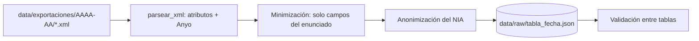

# Proyecto 1 · ITACA

## Bitácora de prácticas → Bloque 1 · Práctica P1: Ingesta de datos ITACA (XML)

### Fuentes de datos

| Tabla | Fichero | Registro XML | Campos ingestados | Frecuencia esperada |
|---|---|---|---|---|
| alumnos | `alumnos.xml` | `<alumno>` | Anyo, NIA, sexo, nacionalidad, provincia, municipio, ensenanza, curso, grupo, turno, linea, modalidad, repite, estado_matricula, tipo_matricula, fecha_matricula, fecha_ingreso_centro | Una exportación por curso escolar; cambia con altas y bajas |
| cursos | `cursos.xml` | `<curso>` | Anyo, codigo, nombre_cas, nombre_val, abreviatura, ensenanza, padre | Una por curso escolar |
| calificaciones | `calificaciones.xml` | `<calificacion>` | Anyo, evaluacion, alumno, ensenanza, curso, contenido, bloque_contenido, nota_numerica, tipo_nota | Cambia en cada evaluación |
| contenidos | `contenidos.xml` | `<contenido>` | Anyo, codigo, nombre_cas, nombre_val, ensenanza, curso | Una por curso escolar |

**Mecanismo de acceso:** exportación XML de ITACA, una carpeta por curso escolar en `data/exportaciones/` (2021-22 a 2025-26), cada una con `alumnos`, `calificaciones`, `contenidos`, `cursos` y `grupos`.

**Estructura de cada XML:**

```xml
<centro codigo="46019660" denominacion="CIPFP MISLATA" curso="2025" fechaExportacion="...">
  <cursos>
    <curso codigo="..." nombre_cas="..." ... />
  </cursos>
</centro>
```

- Los datos van en **atributos**, no en etiquetas hijas.
- Los registros están dos niveles por debajo de la raíz (`centro` → `cursos` → `curso`).
- El campo **Anyo** sale del atributo `curso` de `<centro>`.

### Proceso



1. `leer_tabla` recorre las 5 carpetas de curso y junta los registros de cada tabla.
2. `parsear_xml` lee cada registro con `nodo.get(campo)` y le añade `Anyo`.
3. `anonimizar` sustituye el NIA en `alumnos.NIA` y `calificaciones.alumno`.
4. `guardar` escribe un JSON por tabla en `data/raw/`.
5. `validar` comprueba la coherencia entre tablas.

### Decisiones tomadas

- **Minimización:** solo se guardan los campos del enunciado. Nombre, apellidos, documento, teléfonos, emails, SIP y expediente nunca salen del XML.
- **Anonimización del NIA:** SHA-256 truncado a 10 caracteres. Cada NIA se calcula **una sola vez** (diccionario en memoria) y se reutiliza, así el mismo alumno tiene el mismo código en `alumnos` y `calificaciones` y en todos los cursos.
- **Limitación conocida:** el NIA tiene 8 dígitos, así que un hash sin clave podría revertirse probando todos los valores. Mejora propuesta: añadir una **sal secreta** guardada en `.env`.
- **Un JSON por tabla** con los 5 cursos juntos; el campo `Anyo` los distingue.
- **Buenas prácticas:** `logging` con fecha y nivel, rutas relativas al proyecto, y manejo de errores por fichero (si falta o está mal formado se registra y se sigue) y por tabla.
- `grupos.xml` no se ingesta porque el paso 3 del enunciado no lo pide.

### Resultado

| Tabla | Registros |
|---|---|
| alumnos | 7.193 |
| cursos | 413 |
| calificaciones | 106.814 |
| contenidos | 1.688 |

- **4.304** NIA distintos anonimizados.
- El NIA real de ejemplo `10323382` aparece **0 veces** en los JSON.
- **0** alumnos con un curso inexistente en su año.
- **188** calificaciones (0,18 %) cuyo alumno no aparece en la tabla de alumnos de ese año.

### Incidencias

- El **objetivo** del enunciado habla de cinco tablas (Alumnos, Módulos, Calificaciones, Grupos, Horas), pero el **paso 3** y el esqueleto piden cuatro (alumnos, cursos, contenidos, calificaciones). Se siguió el paso 3.
- El esqueleto usa `findtext()` y `for nodo in raiz`, pero los XML guardan los datos en atributos y un nivel más abajo. Se adaptó con `nodo.get()` y `raiz.find(tabla)`.
- Los XML vienen en una subcarpeta por curso escolar, no en `data/exportaciones/` directamente.
- 188 calificaciones sin alumno en su año: probablemente bajas que no salen en la exportación de alumnos. Se registran, no se eliminan.
- Algunos campos vacíos vienen como un espacio (`" "`), por ejemplo `tipo_matricula`. Se guardan tal cual; la limpieza corresponde a bloques posteriores.

### Uso

```
python -m venv .venv
.venv\Scripts\Activate.ps1
pip install pandas
# Copiar las exportaciones en data/exportaciones/<curso>/
python ingesta\ingesta_itaca_xml.py
```